 

### Lo que construyo

Hago la app móvil de **[identi](https://identi.digital)**, una plataforma de trazabilidad de cacao certificado para cooperativas peruanas.

El técnico de campo llega a una parcela donde no hay señal. Levanta el polígono con GPS, llena un checklist de 36 puntos de certificación orgánica, toma fotos, recoge la firma del productor. Todo offline. Cuando vuelve a tener red, sincroniza.

Del otro lado, esa data se convierte en el expediente que Europa exige bajo el **reglamento EUDR** para probar que ese cacao no viene de tierra deforestada.

> Hoy solo el **8%** de las parcelas tiene georreferencia. Ese número es el problema que estoy ayudando a resolver.

 

### Stack

 

### En qué ando

| | |
|---|---|
| 🛰️ | App móvil offline-first para trazabilidad EUDR |
| 🎓 | Terminando mi tesis — Ing. de Software, UPC |
| 🔐 | Metiéndome en seguridad de aplicaciones móviles |
| 🌱 | Aprendiendo a escribir código que otro pueda mantener |

 

### Hablemos

Estoy abierto a prácticas y oportunidades como desarrollador móvil o full-stack.

